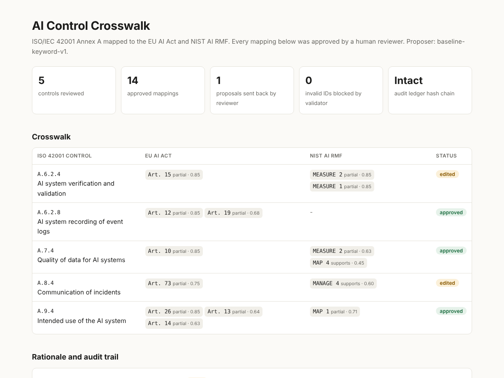

# AI Control Crosswalk Agent

A small LangGraph agent that maps **ISO/IEC 42001 Annex A** controls to the **EU AI Act** and the **NIST AI RMF**, with a **human reviewer in the loop** and a **tamper-evident audit ledger**.

Built in a day as a proof of work for the TruvanAI Engineering Intern (AI Agents and Platform) role.



## The problem

A company that wants ISO 42001 certification and EU AI Act readiness does not want to do the work twice. One piece of evidence (for example, a model validation report) should satisfy every framework that asks for it. That needs a crosswalk: control X in framework A covers article Y in framework B.

Building a crosswalk by hand is slow. Building it with an LLM alone is risky, because an LLM can cite an article that does not exist. This prototype lets the agent do the heavy lifting and keeps the judgement call with a person.

## How it works

```
START → propose → validate → human_review ──approve / edit──→ save → END
           ↑                      │
           └──── reject + note ───┘   (max 3 attempts, then saved as "rejected")
```

| Node | What it does |
|---|---|
| `propose` | Suggests candidate mappings. Two interchangeable proposers: **Claude** (structured output through a forced tool call) or an **offline keyword baseline** that needs no API key. |
| `validate` | Deterministic guardrail. Drops any target ID that is not in the shipped catalog (hallucination block), removes duplicates, clamps confidence, requires a rationale. |
| `human_review` | Calls `langgraph.types.interrupt()`. The graph pauses and checkpoints. The reviewer can **approve**, **edit** (keep a subset), or **reject with a note**. A reject can also **pin** the good proposals so only the weak ones are redone. The note goes back to the proposer as feedback. |
| `save` | Writes one entry to an append-only JSONL ledger. Each entry stores the hash of the previous one, so a silent edit to history is detected by `mapper verify`. |

The report (`out/crosswalk.html`) shows the crosswalk matrix, the rationale per mapping, who approved it and when, every rejected attempt, and every ID the validator blocked.

## Run it

```bash
pip install -r requirements.txt

# Offline, you review each control in the terminal
python -m mapper run

# Same, but Claude proposes the mappings
export ANTHROPIC_API_KEY=...
python -m mapper run --mode llm --reviewer "Your Name"

# Reproducible demo with a scripted reviewer (approve, edit, reject-then-approve)
python -m mapper run --decisions demo/decisions.json --reviewer VB

# All 38 Annex A controls
python -m mapper run --controls all

python -m mapper verify     # check the ledger hash chain
python -m pytest -q         # 19 tests, no network needed
```

Set `TRUVAN_MODEL` to change the Claude model.

## Design decisions

- **The LLM is never trusted directly.** Its output passes a deterministic validator before a human sees it, and a human decision before it is saved. Nothing reaches the ledger without a named reviewer.
- **Reject carries a reason.** A rejection without a note teaches the next attempt nothing, so the CLI requires one.
- **Partial reject.** Reviewers rarely reject everything. Pinning lets them keep the good half and redo the rest.
- **Baseline first.** The keyword baseline is deliberately simple and explainable. It gives a floor to benchmark the LLM against and lets the demo run with no key.
- **Evidence over output.** For an auditor, the attempt history and the hash chain matter as much as the final mapping.

## Data

- `mapper/data/iso42001_annex_a.json`: all 38 Annex A control IDs and titles. Summaries are my own one-line paraphrase; ISO text is copyrighted and not included. The published standard governs.
- `mapper/data/eu_ai_act.json`: 16 articles most relevant to Annex A (Art. 4, 9-15, 17, 19, 25-27, 50, 72, 73).
- `mapper/data/nist_ai_rmf.json`: the 19 NIST AI RMF 1.0 Core categories (GOVERN 1-6, MAP 1-5, MEASURE 1-4, MANAGE 1-4).

## Limits and next steps

- Maps at category level for NIST. Next: subcategory level (for example, MEASURE 2.5).
- The demo mappings come from the keyword baseline plus my review. They are a starting point, not a certified crosswalk.
- Benchmark LLM vs baseline against a reference crosswalk (precision/recall per framework).
- Replace the in-memory checkpointer with a Postgres or SQLite one so reviews survive restarts and can be split across reviewers.
- Add an evidence layer: attach artifacts (policies, test reports) to approved mappings so one upload covers several frameworks.
- Small web UI for the review step instead of the terminal.

This is a prototype, not legal advice.

## License

MIT. See [LICENSE](LICENSE).
